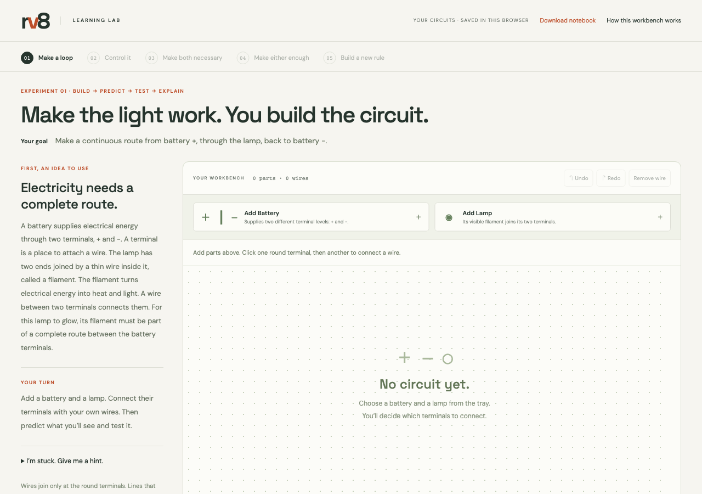

# RV8 learning lab

Learn by constructing connections and investigating their effects. The default experience starts with an empty circuit board, not a prepared CPU or a button that supplies an answer.



## Run locally

From the RV8 repository root:

```sh
python3 -m http.server 4173 --bind 127.0.0.1 --directory web/rv8-learn/dist
```

Open http://localhost:4173/#lab-1. Keep the terminal running. There is no login, installation, or build step. This revision is local-only; it has not been published to the hosted copy.

## Learning sequence

1. Construct a closed route using a battery, a lamp, and your own wires. Predict and test it; remove a wire, then repair the route. Explain a different connection case.
2. Add a switch to your own circuit. Prove it controls the lamp in both positions; an unused or bypassed switch does not meet the goal.
3. Make two switches both necessary. Test all four configurations before naming the behavior AND.
4. Rewire the same components so either switch is enough. Test all four configurations before naming the behavior OR.
5. Build the new rule `(A AND B) OR C` without a prepared circuit. Test all eight configurations and explain the alternative route.

Predictions can be wrong: the observations are evidence to investigate. Changing connections invalidates the current design's table, but preserves previous observations in the notebook. Moving parts does not invalidate evidence. Completion requires the full behavior table plus a transfer question; clicking every control is not sufficient.

The first board is empty. Later boards inherit only the learner's own previous construction. Staged hints are available on request and never create wires automatically. The notebook, circuits, explanations, and progress stay in localStorage, with an in-memory fallback when storage is blocked. A completed notebook can be downloaded as JSON.

## Model and controls

`dist/wiring-engine.mjs` derives circuit behavior from the wire graph and switch contacts. Battery terminals have different levels. A lamp turns on when its ends connect to different source terminals. A direct source-to-source connection cuts power and reports a short. An open switch does not join its ends; a closed switch does. The lamp filament and switch contact are drawn explicitly.

This is an **ideal connectivity model** for one source, one lamp and up to three switches. It does not calculate physical current, voltage magnitude, resistance, brightness, analogue behavior, or real hardware ratings. It is an introduction to constructing and reasoning about circuits, not physical signoff or a full RV8GR simulation. Real transistors and TTL gates require further teaching.

`dist/wire-routing.mjs` routes the drawing around parts; it has no authority over electrical connectivity. Crossing lines do not join. Connections exist only at terminals.

Add a part from the tray. Connect it by clicking two terminal dots. Click a wire and use Remove wire (or Delete). Drag a part by its name, or focus the name and use the arrow keys. On a phone, pan the board; adding a part brings it into view. Undo/redo applies to wiring, placement and part removal. Test setup changes only the input switch positions, never the wiring.

## Verify

Node.js 24 or later runs the tests without installing dependencies:

```sh
node --test web/rv8-learn/test-*.mjs
```

The 29 tests cover circuit behavior and learning progression, including all 64 source/lamp wire graphs, all AND/OR and combined-rule settings, controlled break/repair, invalid designs, stale evidence, malformed notebooks, and restore. The same command runs in the Learning lab GitHub Actions workflow. See [VERIFICATION.md](VERIFICATION.md) for the three review passes and browser checks.

## Continue learning

The [original RV8GR hardware labs](../../RV8GR/doc/labs/README.md), [Thai module tutorial](../../RV8GR/doc/04_understand_by_module.md), and [wiring guide](../../RV8GR/doc/01_wiring_guide.md) remain the hardware references. The browser help links to those guides. This first web module teaches circuit construction and logic rules; it does not yet teach transistor internals, memory construction, or the complete RV8GR CPU.
